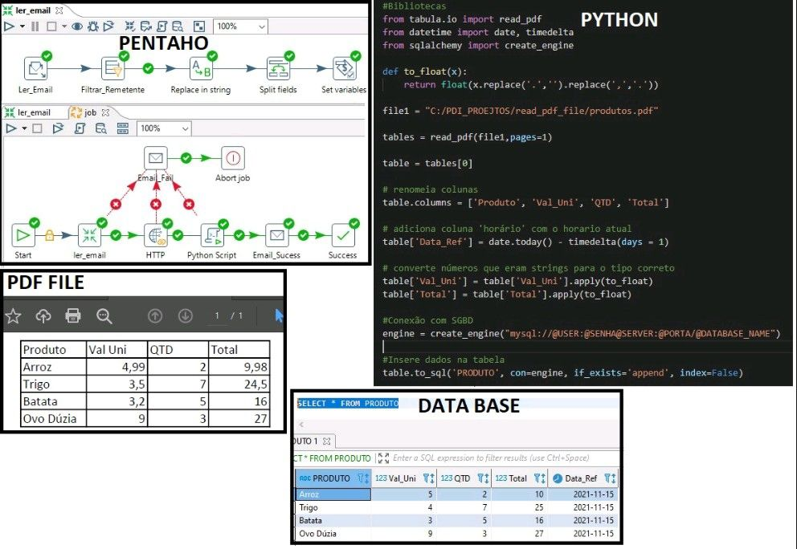

# Pentaho + Python | PDF Data Extraction

## About the Project

This project demonstrates an ETL workflow integrating **Pentaho Data Integration (PDI)** and **Python** to automate the extraction and processing of information from PDF files received by email.

Pentaho is responsible for identifying and retrieving emails containing PDF attachments, while Python handles PDF processing and data extraction. The extracted information is then persisted in a database for further use.

The project demonstrates how different technologies can work together to build an automated data integration process.

## Workflow

The ETL process follows these steps:

1. **Email Monitoring:** Pentaho connects to an email account and identifies messages containing PDF attachments.
2. **File Download:** PDF attachments are downloaded and made available for processing.
3. **Data Extraction:** Python reads and processes the PDF files, extracting the required information.
4. **Data Persistence:** The extracted information is stored in a database.

### Process Overview

```text
Email Account
     |
     v
Pentaho Data Integration
     |
     v
Identify Emails
     |
     v
Download PDF Attachments
     |
     v
Python
     |
     v
Read and Extract PDF Data
     |
     v
Database
```

## Technologies

| Technology | Purpose |
|---|---|
| Pentaho Data Integration (PDI) | ETL orchestration and email integration |
| Python | PDF reading and data processing |
| Database Management System (DBMS) | Data persistence |

## Project Demonstration

The following image illustrates the project workflow:



## Key Concepts Demonstrated

- ETL process orchestration using Pentaho.
- Integration between Pentaho Data Integration and Python.
- Email attachment automation.
- PDF file processing.
- Data extraction and persistence.
- Integration of different technologies in a data engineering workflow.

## Objective

The objective of this project is to demonstrate the integration of Pentaho and Python in an automated ETL pipeline, combining Pentaho's data integration capabilities with Python's flexibility for document processing.

---

**Author:** [Deyvid Linoba](https://github.com/dlinoba)
